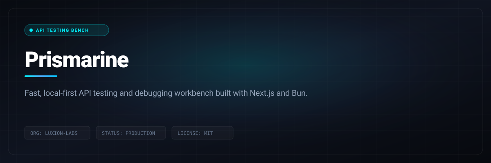

# Prismarine

> Fast, local-first API testing and debugging workbench built with Next.js and Bun.



<p align="center">
  
  &nbsp;
  
  &nbsp;
  
  &nbsp;
  
  &nbsp;
  
  &nbsp;
  
</p>

<p align="center">
  <a href="LICENSE"></a>
  &nbsp;
  <a href="CONTRIBUTING.md"></a>
</p>

---

## Quick Start & Getting Started

Getting Prismarine running locally takes only two steps:

```bash
git clone https://github.com/Luxion-Labs/prism.git
cd prism
bun install && bun run dev
```

Open [http://localhost:3000](http://localhost:3000) in your browser.

---

## Tech Stack

- **Framework**: Next.js (App Router)
- **Language**: TypeScript
- **Package Manager**: Bun
- **Styling**: SCSS (structured architecture)
- **State Management**: Zustand
- **Desktop Integration**: Tauri (preparation in place)

## Setup

### Prerequisites
- Bun (https://bun.sh)

### Installation

```bash
bun install
```

### Development

```bash
bun run dev
```

Open [http://localhost:3000](http://localhost:3000) in your browser.

### Build

```bash
bun run build
bun run start
```

### Linting

```bash
bun run lint
bun run lint:fix
```

## Project Structure

- `app/` - Next.js App Router pages and layouts
- `components/` - Reusable UI components (layout, ui)
- `features/` - Feature-specific business logic (types, stores, apis)
- `lib/` - Utilities, helpers, and Tauri integration
- `styles/` - SCSS with structured architecture (abstracts, base, components)
- `public/` - Static assets

## Features

- Clean feature-based architecture
- Type-safe state management with Zustand
- Structured SCSS with abstracts, base, and component styles
- ESLint configuration for code quality
- Production-ready setup

## License

Proprietary


---

## Maintainer Response SLA
Luxion Labs enforces a strict 24-hour response SLA on all community issues, feature proposals, and pull requests. See [CONTRIBUTING.md](CONTRIBUTING.md) for full development guidelines.

## License
Distributed under the MIT License. See [LICENSE](LICENSE) for details.
